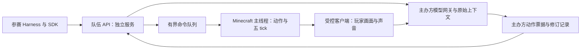

# 参赛 Harness 接入方案与 Starter v0.2

当前交付为**可运行的协议原型**：HTTP API、Python SDK、最小 Harness、两队模拟服务端和接入测试。它没有连接 Minecraft、真实图像/声音或模型网关，不授予正式比赛能力。原有内核管理员 API 继续保持私有，不能直接发给参赛队。

2026-10-19 用户确认：当前只要求一份真实 Harness 的完整试跑，不将八队压测作为前置；Harness 算法、记忆和运行中改动由主办方人工审核。平台交付参赛接入规范、可靠模板、协议与故障处置，见 [队伍接入规范](TEAM_INTEGRATION.md) 和 `config/delivery-scope.json`。

第一版优先解决高中生和高校学生都能复现的接入体验：解压后一条命令运行单 Harness 演示，不需要 Minecraft 账号、模型密钥、Docker 或第三方 Python 运行库。

```sh
python3 sdk/examples/demo.py
```

输出必须注明 `protocol_mock`。默认一份 Harness 完成 12 个屏障、60 个模拟 tick、5 个合成模型操作和 1 次模型提议的配置调整。`native_minecraft / real_model / human_view_capture / strict_certified` 均为 false。可选 `--teams 2` 仅用于屏障回归，不是八队验收要求。Mock 成功不能代替最终配置上的单 Harness 真实游戏试跑。

## 1. 正式接入应采用的边界



参赛队持有独立、绑定本局与本队的 API 凭据，不持有主办方控制令牌、Minecraft 原始连接或模型供应商密钥。正式运行时只准访问队伍 API。SDK 是便捷封装；其他语言和框架按同一 HTTP 协议接入，不能绕开约束。

世界信息从可信采集端直接进入模型网关。Harness 只持有不透明的 `observation_ref`，不能自行提交图片、坐标 JSON、世界描述、提示词消息、记忆摘要或历史重放。原始感知与模型原始输出由主办方管理上下文，禁止检索、摘要、静默删截和外部语义笔记。模型知识与角色判断仍由模型承担。

允许原版 F3。模型读取它实际显示的图像，不由 API 提供坐标、朝向或解析结果。当前没有可信捕获端，因此生产模型入口仍拒绝输入；Mock 的观察引用只是协议句柄，不指向伪造的世界观察。详见 [玩家视角规则](PLAYER_PERCEPTION.md)。

## 2. 七个接入端点

接口文件为 `api/openapi.json`，当前版本 `0.2.0`；所有端点需要 `Authorization: Bearer <team-token>`，除 session 外还必须有 `X-RSAGI-Match`。SDK 从 `RSAGI_MATCH_ID` 锁定本局，不会自动加入重启后的另一局。没有对外上线的正式 API 地址。公开生产环境必须使用 HTTPS，本地 Mock 仅绑定回环地址。

| 方法与路径 | 用途 | 边界 |
| --- | --- | --- |
| `GET /v1/session` | 本队身份、协议版本、公开参数和能力声明 | 不含世界事实；能力声明不等于第三方认证 |
| `GET /v1/round` | 本队已发布轮次、余额、观察引用与 Harness 修订 ID | 重复读取不增加观察；不返回其他队伍的状态或耗时 |
| `POST /v1/decisions` | 请求一次由主办方计量的模型调用 | 接收轮次、观察引用、份额和已有修订 ID；先扣额度再调用 |
| `GET /v1/decisions/{operation_id}` | 查询本队已受理操作 | 返回状态、usage、动作票据和可用修订引用；控制器不接收语义性世界输出 |
| `POST /v1/ready` | 提交模型原始动作的票据并就绪 | 不能上传另一套动作、修改解释或跨轮/跨队使用 |
| `POST /v1/wait` | 本轮不调用模型，保留额度并就绪 | 中性输入；释放上一批持续按键，游戏物理仍在执行窗口继续 |
| `POST /v1/harness/activate` | 应用本次模型提出的受限 Harness 配置修订 | 必须有对应模型票据及来源记录；不能附世界笔记或任意源码 |

正式 API 不提供 `probe`、后台 `observation`、`step`、`console`、`locate`、`pathfind`、`navigate_to`、直接合成、查询附近实体等能力。界面、寻路、采矿与战斗由模型通过低层输入完成。

模型调用请求示例：

```json
{
  "round_id": 4,
  "observation_ref": "observation_opaque_owned_reference",
  "credits": 4,
  "harness_revision": "revision_previously_registered"
}
```

主办方由引用确定对应角色、已完成轮末画面、游戏混音和完整原始上下文。请求额外夹带 `prompt`、`history`、`memory`、`image`、`coordinates` 或 `team_id` 都应拒绝；身份只从凭据绑定取得。

此设计把控制代码和世界认知分开。参赛队开发的自由度主要在赛前提交的提示模板、控制结构与模型驱动的运行中组织调整；不能保留传统 Agent 框架默认的记忆库、RAG、路径规划器或任意外部工具。它不是无约束的通用 LLM 代理 API。

## 3. 轮次、配额、失败与重试

每轮最多一次模型调用，每逻辑秒 4 轮，每轮执行 5 tick。沿用现有核心的每轮一份、上限 16 份；512 生成 token / 10 秒是当前开发参数，1280×720 是 Starter 画面规格，正式数值仍须赛前冻结。推理 token 计入生成额度，输入 token 另记；原始上下文超限时停止，不自动总结。

第一轮已有一份。前三轮 WAIT 后，第四轮可预留四份；这四份在调用前扣除，不因少用、快速返回、超时或无效输出返还。模型完成还不代表游戏已推进：该队提交票据就绪、其他所有队伍也完成后，才统一执行并发布下一轮。先返回的队伍不能多动或多取画面。

每个 POST 必须带 `Idempotency-Key`。同一队伍、同一键及相同请求只能产生一次副作用；重试跨过轮界仍返回原来的受理记录。换请求体或端点复用旧键返回 409；换新键再次调用同一轮也会拒绝。记录在一局期间不淘汰。请求状态不明时复用原键，已拿到操作 ID 后只查询原操作，不能新建调用重试。

受理返回 202，含不透明的操作 ID。HTTP 受理不代表模型已经成功。模型超时或无效动作在预先公布的规则下由主办方显式结算为 WAIT，保留已扣额度；通用供应商故障、感知异常或主办方错误必须全局停赛，不能临时把系统故障归咎给某队。Mock 分别演示截止超时和全局故障，不实现正式一致恢复。

正式适配只以 `RoundCoordinator` 为权威账本，API 不另起一套生产余额。Mock 的 Python 余额只用于本地协议测试，不能作为另一套正式裁判。限流、空闲 Harness 的裁判截止、供应商失败策略和凭据吊销还需正式服务实现。

SDK 只轮询已有操作，并逐步退避至每 250 ms 查询一次；等待轮界和模型的默认客户端期限为 180 秒，覆盖当前上限 16×10 秒的模型预算。它不是裁判截止时间，正式参数改变时须同步配置。生产端的 round 查询应读取已发布的不可变缓存，不让每次轮询回到游戏主线程；可在保持字段语义的前提下补充有界长轮询。

v0.2 的 SDK 对传输失败最多重试两次，复用同一比赛、幂等键和请求体；明确的协议拒绝不重试。`round.active_operation_id` 支持控制器重新启动后接着查询原模型操作。标准 `run_harness()` 按 OPEN/PENDING/DECIDED/READY 恢复，不重复调用模型或应用已激活修订；已全局停赛后的迟到回复不能再生成可执行票据。

## 4. 模型动作接口

`api/model-decision.schema.json` 是交给模型的输出协议，与 Harness 的 HTTP 请求分开。每次动作有简短 `evidence / reason / expected`，不索取隐藏思维链。

| 动作 | 示例/参数 | 执行要求 |
| --- | --- | --- |
| `INPUT` | `keys`、相对 `look_delta`、可选 `hotbar` | 持续输入只覆盖本批五 tick；无绝对世界坐标或自动导航 |
| `GUI_CLICK` | 画面像素 `x/y`、左右键、Shift | 只操作当前打开界面；不接受后台容器槽位语义或物品 ID 查询 |
| `KEY_PRESS` | `f3`、`inventory`、`escape` | 正常界面按键，下一轮获取结果，无免费额外截图 |
| `CHAT` | 普通聊天文字 | 按赛项通信规则生效，禁止斜杠指令旁路 |
| `WAIT` | 无其他参数 | 中性输入 |

模型产生动作和解释后，主办方保存原文、校验并生成绑定本队/轮次/调用/修订的票据。Harness 的 ready 只选择提交该票据，不重新编造动作或解释。票据提交权不赋予移动世界或读取真值的权限。

零调用 WAIT 在审计中明确记为“积攒额度、未调用模型”的控制操作，不伪造一段模型推理。模型依据世界观察选择的战术性等待，则应作为有简短解释的模型 WAIT 输出保留。两者都不允许控制器自行生成世界判断。

当前模型网关的诊断格式使用绝对相机角度和槽位编号，内核只接 WAIT/LOOK；这里的相对鼠标/像素界面协议是新接入合同，**尚未接入原生执行器**。不能把 schema 中列出某动作当作已经能在 Minecraft 执行。

## 5. 最小 Harness 与运行中自组织

入口见 `sdk/examples/baseline.py`。队伍推荐复用 `run_harness()` 的网络与状态处理，它只保留轮次、余额、操作/观察/修订句柄，不建世界状态表：

```python
from rsagi_harness import CompetitionClient, run_harness

client = CompetitionClient.from_env()
run_harness(client)
```

本地演示首先积攒四份，由模拟模型提出把内部角色从 `actor` 改为 `observer + actor`，后续调用目标改为两份。主办方登记来源操作、父修订、不可变新修订及激活记录。后续角色配置和预算选择发生变化，但仍只有每轮一次调用；角色数不能换来额外模型或 token 配额。真实队伍可在提交模板中设计角色职责，内部组织改变必须来自已计量模型输出。

当前 SDK 只演示受限配置自组织，不执行任意 Python/Java 热更新。参赛 Harness 可以提交自身运行中改动的实现及边界，由主办方审核；这不是要求主办方先实现自动源码合规证明器。

禁 RAG、外部语义笔记和传统规划器的规则不变，其内容合规由主办方人工审核。平台只验证请求结构、身份、配额、轮次和动作票据，避免把“自动识别任意代码中的语义存储”扩大成当前交付前置。公开接口也不授予后台真值或管理员权限。

对已使用其他框架的队伍，迁移清单是：将模型调用替换为官方 `decide`，移除自建记忆与直接游戏工具，把控制逻辑接到 round/wait/receipt/revision 回调；先通过本地合同测试，再申请在线训练。SDK 不会自动让已有框架合规。

## 6. 线程边界与 20 TPS

队伍 HTTP API 和模型网关运行于独立服务/工作线程。模型等待、网络收发、画面编码和文件 I/O 不应占用 Minecraft 主线程。

世界读写、玩家动作及裁判事件则由主办方游戏适配器在 Minecraft 主线程处理，通过有界队列与后台服务交接。全队屏障使用模拟门控，不能用主线程 sleep 等模型，也不能直接从异步线程操作世界。[Paper 调度说明](https://docs.papermc.io/paper/dev/scheduler/)

本仓库只有协议 Mock，不包含游戏适配器或主办方后台代码。当前按一份真实 Harness 的最终配置试跑验收，不要求八队压测；Mock 吞吐量不能替代这次真实服务器运行。

## 7. 发布包与落地顺序

Starter 发布包应包含：版本化 OpenAPI 与模型动作 schema、Python SDK、最小 Harness、模拟服务端、合同测试及指南；不含主办方令牌、供应商密钥、存档、种子或后台坐标。`scripts/package_harness_sdk.py` 只打明确列出的公开文件。

正式报名还需要上传完整源码、依赖锁定与启动入口，授权主办方审计并于赛后公开赛事 GitHub；运行中产生的源码修订也要归档。上传/审批/正式运行器不是这七个游戏接入端点的一部分，目前尚未实现。API 只给本队能力，不支持向其他队伍推送私下带外消息。

推进顺序：

1. 发布并试用当前协议包，收集高中/大学团队接入问题，冻结 v1 的字段和错误语义。
2. 完成可信原生客户端画面/声音与完整低层输入，将同一队伍 API 接到现有原生屏障、权威账本和模型网关；生产端不接受 Mock 或后台文本回退。
3. 按主办方人工审核后的准入规则，使用最终服务器、模型和客户端配置完成一份真实 Harness 的运行与故障演练，检查逻辑时钟、配额、输入输出、计分及主线程耗时。八队压测和自动 Harness 合规认证不作为当前前置。

验证与打包：

```sh
python3 scripts/verify_harness_api.py
python3 scripts/package_harness_sdk.py
```

协议描述按 [OpenAPI 3.1.1](https://spec.openapis.org/oas/v3.1.1.html) 编写；HTTP 202 表示已受理，409 表示与当前状态冲突，语义依据 [RFC 9110](https://www.rfc-editor.org/rfc/rfc9110.html)。`Idempotency-Key` 的重放、保留及冲突行为是本赛事明确定义的应用协议，不能仅靠该 header 名字假定服务已实现。
